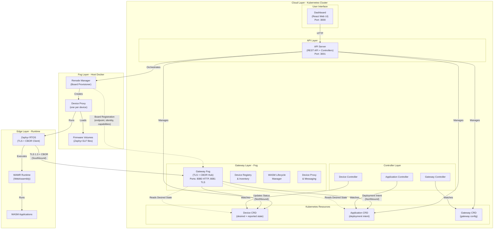

# Kubernetes-native WASM edge orchestration (Wasmbed)

Wasmbed is a research prototype that manages WebAssembly applications on constrained edge devices with Kubernetes primitives. Devices, applications and gateways are Custom Resources; controllers reconcile them; a **gateway** talks to the devices over mutually authenticated TLS 1.3 with CBOR messages (enrollment, heartbeat, deploy/stop). Devices are emulated ARM Cortex-M boards (Renode) running Zephyr RTOS with the WAMR WebAssembly runtime. The workspace is written in Rust, the dashboard in React.

Why: to test whether the Kubernetes declarative model can orchestrate a cloud-fog-edge continuum down to microcontrollers, and to measure it (a 100-trial campaign is included under `experiments/`).

> Verified in this environment: Rust library crates build and their tests pass; scripts/YAML pass static checks. **Not verified in this environment**: the K3s deployment, Docker images, dashboard build, Zephyr firmware, Renode emulation, the experiment campaign.

## Contents

1. [Architecture](#1-architecture) 2. [Requirements](#2-requirements) 3. [Installation](#3-installation-step-by-step) 4. [Configuration](#4-configuration) 5. [Usage end to end](#5-usage-end-to-end) 6. [Testing and verification](#6-testing-and-verification) 7. [Repository structure](#7-repository-structure) 8. [Troubleshooting](#8-troubleshooting) 9. [Limitations and security](#9-limitations-and-security) 10. [Extending](#10-extending) 11. [Further documentation](#11-further-documentation)

## 1) Architecture

Layers: **cloud** (Kubernetes: API server, gateway, dashboard, controllers), **fog** (Renode containers/proxies on cluster nodes), **edge** (Zephyr + WAMR inside the emulated device).



Key flows (details and sequence diagrams in `doc/ARCHITECTURE.md` and `doc/SEQUENCE_DIAGRAMS.md`): the API server writes `Device`/`Application`/`Gateway` CRs and orchestrates Renode; the device connects to the gateway over TLS 1.3 + CBOR (southbound); the gateway reports status into CRs and reads desired state from them (northbound); controllers watch the CRs.

## 2) Requirements

| Item | Version |
|---|---|
| Rust | 1.88.0 or newer (`rust-version` in `Cargo.toml`; 1.99.1 was used for the checks) |
| OpenSSL dev files, `pkg-config` | needed by api-server, gateway, controllers, infrastructure, qemu-manager (`apt install pkg-config libssl-dev`) |
| Kubernetes | K3s (or Kubernetes 1.24+), `kubectl` |
| Docker | with a local registry on `localhost:5000` (set up by `deploy-k3s.sh`) |
| Node.js + npm | for `dashboard-react` (React app, `npm install && npm start`) |
| Renode, Zephyr SDK 0.16.5+ | for emulation and firmware builds (optional) |
| Host tools for device networking | `dnsmasq`, `iptables`, `ip` (sudo) |

## 3) Installation step by step

```bash
# Build and test the Rust libraries (verified, no cluster needed)
git clone https://github.com/lucadagati/k3s-wasm-edge-orchestration.git
cd k3s-wasm-edge-orchestration
cargo test --locked -p wasmbed-protocol -p wasmbed-wasm-runtime -p wasmbed-types -p wasmbed-cert -p wasmbed-tls-utils

# Full platform (not verified in this environment)
curl -sfL https://get.k3s.io | sh -s - --write-kubeconfig-mode 644
mkdir -p ~/.kube && sudo cp /etc/rancher/k3s/k3s.yaml ~/.kube/config && sudo chown $(id -u):$(id -g) ~/.kube/config
./scripts/deploy-k3s.sh          # builds images, local registry, applies k8s/ manifests, generates TLS certs
kubectl get pods -n wasmbed
kubectl port-forward -n wasmbed svc/wasmbed-dashboard 3000:3000 &    # http://localhost:3000
kubectl port-forward -n wasmbed svc/wasmbed-api-server 3001:3001 &   # http://localhost:3001
```

Gateway TLS certificates are generated by `scripts/generate-gateway-certs.sh [output_dir]` (default `config/certs/`, git-ignored). Clean up with `./scripts/cleanup-k3s.sh`.

## 4) Configuration

| Setting | Where | Value / meaning |
|---|---|---|
| Platform config | `config/wasmbed-config.yaml` | gateway defaults: `max_devices` 100, `heartbeat_interval` 30 s, `connection_timeout` 60 s, `enrollment_timeout` 300 s, TLS port 30452, HTTP port 30453 |
| Gateway instances | `config/wasmbed-config.yaml` (`gateways.instances`) | gateway-1 (30452/30453), gateway-2 (30454/30455), gateway-3 (30456/30457, disabled) |
| Images | `k8s/deployments/*.yaml` | `localhost:5000/wasmbed/<component>:latest` |
| Service ports | README / manifests | dashboard 3000, API server 3001, gateway HTTP 8080 / TLS 8081 (cluster), NodePorts 30452+ |
| CRDs | `k8s/crds/` | `Device`, `Application`, `Gateway` |
| Board definitions | `k8s/devices/`, `renode-scripts/` | MCU/RISC-V boards, Renode platform scripts |
| Experiment knobs | env `TRIALS` (100), `ABLATION_TRIALS` (30) | `scripts/run_experiment_campaign.sh` |

## 5) Usage end to end

```bash
# 1. create a device (API server on :3001)
curl -X POST http://localhost:3001/api/v1/devices -H "Content-Type: application/json" \
  -d '{"name":"my-device","deviceType":"MCU","mcuType":"Stm32F746gDisco","gatewayId":"gateway-1"}'
# 2. start emulation
curl -X POST http://localhost:3001/api/v1/devices/my-device/renode/start
# 3. configure host networking for the emulated Ethernet device (see below), then connect/enroll
curl -X POST http://localhost:3001/api/v1/devices/my-device/connect
# 4. deploy an application (Dashboard > Applications, or POST /api/v1/applications)
kubectl get devices,applications -n wasmbed
```

Other API routes (from `crates/wasmbed-api-server/src/main.rs`): `GET /health`, `GET /api/v1/status`, `GET|POST /api/v1/devices|applications|gateways`, `DELETE /api/v1/devices/:id`, `POST /api/v1/devices/:id/enroll|connect|disconnect`, `POST /api/v1/devices/:id/emulation/start|stop`, `POST /api/v1/gateways/:id/toggle`.

Expected: the device moves Enrolled -> Connected once the TLS session to the gateway is up; the Application CR reaches `Running`. Not verified in this environment. Guided walkthrough: `doc/TEST_GUIDE.md`, `scripts/verify-tls-and-deploy.sh`.

### Recorded results (committed data, not re-run here)

`experiments/20260609-070246/` holds a 100-trial hardened campaign: 100/100 successes on every stage (Wilson 95% CI 96.3% to 100%). Latency in ms (mean, 95% CI): enrollment 583.9 [567.5, 600.3]; heartbeat 4.4 [4.3, 4.6]; deployment 601.9 [567.5, 636.3]; transactional (all stages) 1185.8 [1152.8, 1218.7]. Goodput: enrollment 1.713/s, heartbeat 225.56/s, deployment 1.661/s. Reproduce with `TRIALS=100 ABLATION_TRIALS=30 ./scripts/run_experiment_campaign.sh` (see `doc/EXPERIMENTS.md`).

### Emulated device networking (TAP + DHCP + routing), not verified in this environment

When you use an **Ethernet-capable** board (e.g. `Stm32F746gDisco`) and call **Connect**, Renode creates a **TAP** interface on the host (`tap0`) so the emulated device can use the network. For the firmware to get an IP via DHCP and reach the Gateway pod (TLS), you must configure the host once per session (or after each reboot if you use the same machine).

**1. After Connect, configure the TAP interface** (requires sudo):

```bash
sudo ip addr add 192.168.1.1/24 dev tap0
sudo ip link set tap0 up
```

**2. Install and run DHCP on tap0** (so the emulated device gets an IP, e.g. 192.168.1.2):

```bash
sudo apt-get update && sudo apt-get install -y dnsmasq
sudo systemctl stop dnsmasq 2>/dev/null
sudo systemctl mask dnsmasq 2>/dev/null
sudo dnsmasq -p 0 --bind-interfaces -i tap0 --listen-address=192.168.1.1 \
  --dhcp-range=192.168.1.2,192.168.1.254,255.255.255.0,1h \
  --dhcp-option=3,192.168.1.1 -k &
```

**3. Enable forwarding and NAT** toward the cluster (so 192.168.1.x can reach the Gateway pod, e.g. 10.42.0.43):

```bash
sudo sysctl -w net.ipv4.ip_forward=1
sudo iptables -t nat -A POSTROUTING -s 192.168.1.0/24 -o cni0 -j MASQUERADE
sudo iptables -A FORWARD -i tap0 -o cni0 -j ACCEPT
sudo iptables -A FORWARD -i cni0 -o tap0 -m state --state RELATED,ESTABLISHED -j ACCEPT
```

**Summary:** `tap0` is created by Renode at Connect; you give it the address 192.168.1.1/24 and bring it up. dnsmasq provides DHCP on that subnet so the firmware gets an IP; IP forwarding and NAT allow that traffic to reach the Kubernetes pod network (e.g. Gateway at 10.42.0.43). Without this setup, the device stays in "Enrolled" and never reaches "Connected" (no TLS).


## 6) Testing and verification

Verified here (Rust 1.99.1, `--locked`):

```bash
cargo test --locked -p wasmbed-protocol -p wasmbed-wasm-runtime -p wasmbed-types -p wasmbed-cert -p wasmbed-tls-utils
# all "test result: ok" (25 tests in total across these crates)
cargo check --workspace --locked --exclude wasmbed-api-server --exclude wasmbed-application-controller \
  --exclude wasmbed-device-controller --exclude wasmbed-gateway --exclude wasmbed-gateway-controller \
  --exclude wasmbed-infrastructure --exclude wasmbed-qemu-manager      # compiles, warnings only
```

The excluded crates need `pkg-config` and `libssl-dev`; they were not built here. The WASM runtime tests compile `crates/wasmbed-wasm-runtime/test_data/*.wat` at test time (the `.wasm` binaries are git-ignored). Scripts pass `bash -n`, Python scripts compile, `k8s/` and `config/` YAML parse. Not verified in this environment: `scripts/test_enrollment.py` (needs a gateway), `scripts/verify-tls-and-deploy.sh`, cluster deployment, dashboard tests.

## 7) Repository structure

| Path | Content |
|---|---|
| `crates/wasmbed-api-server` | REST API, dashboard backend, Renode orchestration |
| `crates/wasmbed-gateway` | TLS/CBOR hub: enrollment, heartbeat, deployment, local cache, HTTP API |
| `crates/wasmbed-{device,application,gateway}-controller` | CR controllers |
| `crates/wasmbed-k8s-resource` (+`-tool`) | CRD Rust types and clients |
| `crates/wasmbed-protocol`, `wasmbed-types`, `wasmbed-cert`, `wasmbed-tls-utils` | wire protocol (CBOR), shared types, certificates, TLS helpers |
| `crates/wasmbed-wasm-runtime` | host-side WASM runtime with security/validation layers |
| `crates/wasmbed-qemu-manager`, `wasmbed-tcp-bridge`, `wasmbed-edge-client`, `wasmbed-infrastructure`, `wasmbed-config` | emulator manager, TCP bridge, edge client, CA/secret/log/monitoring services, config loader |
| `zephyr-app/` | Zephyr firmware (C): TLS+CBOR client and WAMR integration |
| `renode-scripts/` | Renode platform scripts (nRF52840, STM32F4, Arduino Nano BLE, ...) |
| `dashboard-react/` | React dashboard |
| `k8s/` | CRDs, RBAC, deployments, gateways, devices, ingress, test resources |
| `config/` | platform config |
| `scripts/` | deploy, networking, validation, experiment automation (see `scripts/README.md`) |
| `experiments/` | recorded campaign data and figures |
| `doc/` | architecture, sequence diagrams, TLS, firmware, MCU support, test guide |
| `Dockerfile.*` | one image per service |

## 8) Troubleshooting

| Symptom | Action |
|---|---|
| `failed to run custom build command for openssl-sys` | install `pkg-config libssl-dev` |
| Device stays "Enrolled", never "Connected" | host TAP/DHCP/NAT not configured: see networking section, or `sudo ./scripts/setup-renode-net.sh` |
| API not reachable on 3001/8080 | `./scripts/ensure-experiment-runtime.sh` restarts the port-forwards |
| Pods `ImagePullBackOff` | local registry `localhost:5000` missing; rerun `deploy-k3s.sh` |
| Gateway TLS errors | regenerate certs with `scripts/generate-gateway-certs.sh`; see `doc/TLS_CONNECTION.md` |
| Runtime tests: missing `.wasm` | fixed: `.wat` fixtures are compiled at test time |

More in `doc/K3S_DEPLOYMENT.md` and `doc/RENODE_TLS_DEPLOY_VERIFICATION.md`.

## 9) Limitations and security

- Research prototype; devices are emulated, real-hardware support is documented but not verified here (`doc/MCU_SUPPORT.md`).
- Single K3s node, local unauthenticated registry, `localhost:5000` images with `latest` tags.
- The API server and dashboard have no authentication in the default deployment; do not expose ports 3000/3001 beyond a trusted network.
- Certificates are generated locally for test use (`config/certs/`, git-ignored): do not commit or reuse them.
- Device networking requires sudo `iptables`/`ip` changes on the host.

## 10) Extending

1. New board: add a Renode script in `renode-scripts/`, a device manifest in `k8s/devices/`, and document it in `doc/MCU_SUPPORT.md`.
2. New protocol message: extend `crates/wasmbed-protocol` (CBOR types), handle it in `wasmbed-gateway` and in `zephyr-app/src/wasmbed_protocol.c`, and add a test.
3. New WASM host function: add a module under `crates/wasmbed-wasm-runtime/src/host_functions/` (see `hello_world.rs`) and register it.
4. New CRD field: update `crates/wasmbed-k8s-resource`, the YAML in `k8s/crds/`, and the controller.
5. New experiment stage: extend `scripts/collect_experiment_metrics.py` and `postprocess_experiment.py`.

## 11) Further documentation

`doc/README.md` indexes the guides: ARCHITECTURE, SEQUENCE_DIAGRAMS, TLS_CONNECTION, K3S_DEPLOYMENT, RENODE_TLS_DEPLOY_VERIFICATION, TEST_GUIDE, EXPERIMENTS, FIRMWARE, MCU_SUPPORT.

## License

See `LICENSE`.
